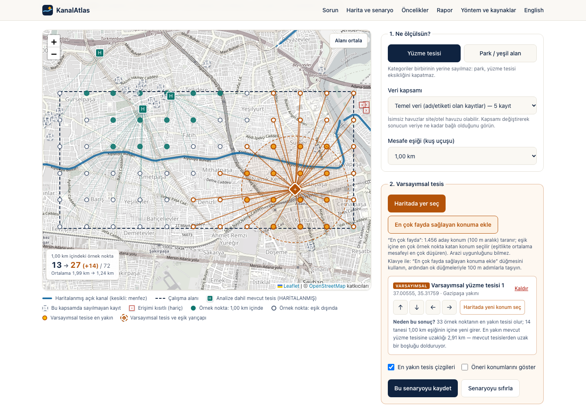

# KanalAtlas

**Mahalleni keşfet. İhtiyaçları gör. Geleceği birlikte düşün.**
*Explore your neighbourhood. Understand its needs. Imagine a better future.*

KanalAtlas is a working, open-source geospatial decision-support prototype for one real canal corridor in Adana, Türkiye. It measures straight-line access from 72 sampled map locations to mapped swimming facilities and parks. Users can place and drag hypothetical facilities and see the metrics recomputed live, compare locations under identical settings, record their own priorities, and download a Turkish planning brief (PDF) containing the actual results, sources and limitations.

**Live demo:** https://deniz2077.github.io/kanalatlas/  ·  **Code:** https://github.com/deniz2077/kanalatlas

Built for **Neighborhood Hacks 2026** by Deniz Efe Bulut, with AI coding assistance (see [AI disclosure](submission/AI_DISCLOSURE.md)).



## The problem

- Open irrigation canals run through residential neighbourhoods of Adana. In its **12 June 2026** decision, Adana Metropolitan Council listed preventing drownings in unsafe places **such as irrigation canals** among the reasons for free summer swimming lessons ([source](docs/EVIDENCE.md#e1-council-decision-yüzme-bilmeyen-çocuk-kalmasın-protocol--verified)).
- In 2025 the municipality reported free lessons for about 10,000 children in 26 pools, but published no locations, so neighbourhood-level access is hard to see.
- The Ministry of Agriculture announced (10 Sept 2025) that open canals through the city centre will be replaced by closed pressurised pipes. No timeline was given.

KanalAtlas connects these fragments. **What it adds to a normal map:** it *measures* access, it *recalculates* what a proposed facility would change, it *compares* sites with one method, it shows how much the answer depends on which data you trust, and it turns this into a shareable, sourced brief.

## Features (all working and tested)

- Interactive Leaflet map of the Seyhan central canal corridor: mapped canals, study area, 72 sample points, facility markers with OSM source links and status labels.
- Swimming and park categories, analysed separately; a data-scope switch (core vs. all mapped records); selectable thresholds.
- Up to 3 hypothetical facilities: click to place, **drag with live recalculation**, tap-to-move, keyboard arrow buttons (100 m), and a “best location” button that screens 1,456 candidate sites.
- Results: points within the threshold, mean/median/max distance, a canal-belt subset (≤ 500 m from a mapped canal), a per-facility “why this result?” explanation, and a plain-language interpretation.
- **“Kanal kapatılırsa ne olur?”** In the park category, turn the mapped canal line (6.82 km) into a hypothetical linear park. Distance is measured to the nearest point on the line, which models the announced canal decommissioning (closure and land availability are not verified).
- Saved scenarios A/B/C re-evaluated with identical settings in a comparison table.
- A full text-table alternative to the map, and a facility list with statuses and sources.
- “Mahallen İçin Ne Önemli?”: a local-only priorities form (no server, no personal data, clearly *not* a survey), downloadable as JSON.
- A PDF planning brief generated from the current state, including a schematic map drawn from the same coordinates.
- **English by default, with a one-click Turkish (TR/EN) toggle** for the whole interface and the PDF report; keyboard-only operation (tested); **0 axe-core WCAG 2.1 A/AA violations** (tested); mobile layout.

## Quick start

Requires Node 20+.

```bash
npm install
npm run dev            # http://localhost:3000
```

| Command | What it does |
|---|---|
| `npm test` | 79 unit tests (geometry, scenario engine, corridor, data, PDF content) |
| `npm run build && npx playwright install chromium && npm run e2e` | Production build + browser tests: journeys, corridor, keyboard-only, axe WCAG A/AA audit (desktop + mobile) |
| `npm run build:static && npm run e2e:static` | Static export (for GitHub Pages) served under `/kanalatlas/` + the same browser tests |
| `npm run proof` | Prints a real-data A/B scenario table (`docs/PROOF_RUN_OUTPUT.md`) |
| `npm run data:build` | Rebuilds `src/data/kanalatlas-data.json` from the committed OSM extract |
| `npm run demo:record` | Records the captioned demo walkthrough from the real app (needs `npm run build` first) |
| `npm run typecheck` / `npm run lint` | TypeScript and ESLint |

## How it calculates

For each sample point: the Haversine great-circle distance to the nearest active facility (R = 6,371,008.8 m). A hypothetical facility replaces it only if strictly closer. **This is straight-line distance, not walking distance; sample points are not people.** A full method with a hand-checkable worked example is in [docs/SCENARIO_METHOD.md](docs/SCENARIO_METHOD.md).

Real-data example (swimming, 1 km): baseline **13/72** points; a hypothetical pool in the east (Gazipaşa) → **27/72**; the same pool in the west (İsmetpaşa) → **21/72** ([proof run](docs/PROOF_RUN_OUTPUT.md)). Counting unnamed pools as well gives a baseline of 44/72, so the data-trust question matters. Parks (300 m): baseline 32/72; best single new park 34/72; **canal corridor as a linear park 44/72**, and canal-belt points within 300 m go from 12/27 to 24/27.

## Architecture

Static Next.js 15 + TypeScript app (also exportable as plain files and deployed by `.github/workflows/pages.yml`); pure calculation modules in `src/lib/` (no UI code); Leaflet only draws. See [docs/ARCHITECTURE.md](docs/ARCHITECTURE.md).

```
src/lib/geo.ts         Haversine, projections, point-to-segment, polygon centroid
src/lib/facilities.ts  OSM → facilities: classification + duplicate merging
src/lib/scenario.ts    evaluation grid, before/after engine, site suggestions, validation
src/lib/report.ts      PDF document built from state
src/components/        KanalAtlasApp (state), MapView (Leaflet), PrioritiesForm
scripts/               build-dataset, proof, record-demo
data/raw/              committed Overpass query, response and timestamp
```

## Data and sources

- **Map data:** © OpenStreetMap contributors (ODbL), extracted once on 2026-10-22 via Overpass. 13 canal ways and 240 facilities (14 duplicates merged). No facility is claimed to be open, free or public: all are labelled *MAPPED*.
- **Problem evidence:** Adana Metropolitan Council decisions (12.06.2026), the municipal news page (21.07.2025) and the Ministry of Agriculture announcement (10.09.2025). See the [evidence ledger](docs/EVIDENCE.md) with status labels.
- **Basemap tiles:** OpenStreetMap Foundation tile server (attribution shown).

## Limitations

Straight-line distance only. OSM may be incomplete and facility status is unverified. There is no population data, no drowning-risk prediction and no land, cost or feasibility assessment. One study area only. Touch-drag on real phones is not yet verified (tap-to-move is). No community input has been collected yet.

## Documentation

- [Study area](docs/STUDY_AREA.md) · [Evidence](docs/EVIDENCE.md) · [Method](docs/SCENARIO_METHOD.md) · [Architecture](docs/ARCHITECTURE.md) · [Engineering decisions](docs/ENGINEERING_DECISIONS.md)
- [Proof of functionality](docs/PROOF_OF_FUNCTIONALITY.md) · [Self-review against the rubric](docs/JUDGE_REVIEW.md) · [Owner review guide](docs/OWNER_REVIEW.md)
- Submission drafts: [`submission/`](submission/)

## AI assistance

This prototype was implemented with substantial help from an AI coding assistant (Claude Code), directed and reviewed by the student. Details: [submission/AI_DISCLOSURE.md](submission/AI_DISCLOSURE.md).

## Future work

Walking-network distances; a verified municipal pool list; consent-based community responses; more neighbourhoods; a canal-corridor intervention type for the post-closure future. See [submission/FUTURE_WORK.md](submission/FUTURE_WORK.md).

## Licence

Code: MIT (see `LICENSE`). Map data: ODbL © OpenStreetMap contributors.
